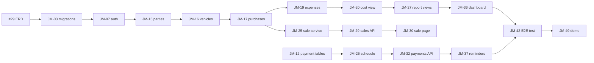

# Task Guide

All project tasks, split into backend and frontend, with the order to start them.
The same tasks are on the project board: https://github.com/orgs/NSBM-GROUP-Assignments/projects/2
Each card on the board has the full steps, where the code goes, and a done checklist.

**Timeline:** Mon 2 Nov – Fri 27 Nov 2026 · code freeze Wed 25 Nov · demo Fri 27 Nov

| Area | Tasks | Estimated days |
|---|---|---|
| Backend (API + database) | 25 | 34.5 |
| Frontend (UI screens) | 9 | 16 |
| Backend + Frontend | 15 | 21 |
| **Total** | **49** | **71.5** |

JM-02 (ERD sign-off) is covered by the existing issue **#29**, so it is not a separate card.

## Member roles

| Code | Member | Area of work |
|---|---|---|
| M1 | Member 1 | Database setup and integration |
| M2 | Member 2 | Staff login, roles and document access |
| M3 | Member 3 | Motorcycle inventory and purchases |
| M4 | Member 4 | Repairs and refurbishment costs |
| M5 | Member 5 | Sales and payment agreements |
| M6 | Member 6 | Installments, payments and receipts |
| M7 | Member 7 | Dashboard, reports and reminders (also owns the frontend setup) |

---

## Starting order

Tasks in the same step can run at the same time. Start a step once the tasks it depends on are merged into `dev`.

### Week 1: Foundations

| Step | Start these | Waiting on |
|---|---|---|
| 1 (day 1) | **#29** ERD sign-off (everyone reviews), **JM-01** backend setup, **JM-05** frontend setup, **JM-06** Firebase | nothing |
| 2 | **JM-03** first migrations, **JM-09** API spec (inventory), **JM-13** UI kit, **JM-14** setup check | #29, JM-01, JM-05 |
| 3 | **JM-04** seed + CI, **JM-07** auth middleware, **JM-08** login page, **JM-10 / JM-11 / JM-12** specs + migrations | JM-03, JM-06 |

### Week 2: Buy and refurbish

| Step | Start these | Waiting on |
|---|---|---|
| 4 | **JM-15** parties API, **JM-22** documents API, **JM-24** audit + staff API, **JM-26** installment schedule, **JM-28** test deploy | JM-07, JM-12 |
| 5 | **JM-16** vehicles API, **JM-23** document component | JM-15, JM-22 |
| 6 | **JM-17** acquisition cycle API | JM-16 |
| 7 | **JM-18** inventory pages, **JM-19** expenses API, **JM-25** sale service | JM-17 |
| 8 | **JM-20** direct cost view | JM-19 |
| 9 | **JM-21** refurbishment pages, **JM-27** report views | JM-20 |

### Week 3: Sell and collect

| Step | Start these | Waiting on |
|---|---|---|
| 10 | **JM-29** sales API, **JM-32** payments API, **JM-36** dashboard, **JM-38** staff admin page, **JM-39** expiry records, **JM-40** expense report, **JM-41** integration + indexes | JM-25, JM-26, JM-27, JM-24, JM-16, JM-20 |
| 11 | **JM-30** sale page, **JM-31** concurrency test, **JM-33** receipts, **JM-34** payment tests, **JM-35** agreement pages, **JM-37** reminders | JM-29, JM-32, JM-39 |

### Week 4: Test and release

| Step | Start these | Waiting on |
|---|---|---|
| 12 | **JM-42** end-to-end test, **JM-43** backup/restore, **JM-44** security pass, **JM-45 – JM-48** module tests + docs, **JM-50** bug fixing | everything above |
| 13 | **JM-49** final deploy and demo | JM-42 |

### Critical path

These tasks block the most work. If one of them slips, the whole plan slips, so help their owners first.

### Where each member starts

| Member | First task | Next | While waiting |
|---|---|---|---|
| M1 | JM-01 backend setup | JM-03 migrations | — |
| M2 | JM-06 Firebase | JM-07 auth middleware | — |
| M3 | Review #29 ERD | JM-09 API spec, then JM-15 | Read the inventory requirements |
| M4 | Review #29 ERD | JM-10 expenses spec + migration | Plan the expense screens |
| M5 | Review #29 ERD | JM-11 sales spec + migration | Plan the double-sale protection |
| M6 | Review #29 ERD | JM-12 payment specs + migrations | Work out the installment maths |
| M7 | JM-05 frontend setup | JM-13 UI kit | — |

---

## Backend tasks (API + database)

Code goes in this repo (`backend_Backoffice`).

| ID | Task | Owner | Week | Days | Depends on |
|---|---|---|---|---|---|
| JM-01 | Backend setup: TypeScript, Express skeleton, lint, npm scripts, Docker Compose (Postgres + pgAdmin) | M1 | 1 | 1.5 | – |
| JM-03 | First migrations: users, roles, parties, vehicles, vehicle_identifiers, acquisition_cycles | M1 | 1 | 1.5 | #29 |
| JM-04 | Seed data, test database, CI (lint + tests on every PR) | M1 | 1 | 1 | JM-03 |
| JM-07 | authenticate + authorize middleware, /me endpoint, dev bypass token | M2 | 1 | 2 | JM-03, JM-06 |
| JM-09 | API spec: parties, vehicles, acquisition cycles | M3 | 1 | 0.5 | #29 |
| JM-10 | API spec and migration: refurbishment_expenses | M4 | 1 | 1 | JM-03 |
| JM-11 | API spec and migration: sales, idempotency_keys | M5 | 1 | 1 | JM-03 |
| JM-12 | API spec and migrations: agreements, installments, payments, allocations, receipts | M6 | 1 | 1.5 | JM-03 |
| JM-15 | Parties API: buyers and sellers, search by name, phone or NIC | M3 | 2 | 1.5 | JM-07, JM-09 |
| JM-16 | Vehicles API with identifier history, search, filter, sort | M3 | 2 | 2 | JM-15 |
| JM-17 | Acquisition cycle API: record purchase (seller, date, price) | M3 | 2 | 1.5 | JM-16 |
| JM-19 | Expenses API: parts, labour, provider; condition and status to ready_for_sale | M4 | 2 | 2 | JM-10, JM-17 |
| JM-20 | v_cycle_cost view and direct-cost endpoint | M4 | 2 | 0.5 | JM-19 |
| JM-22 | Documents API: upload to Storage, metadata in DB, short-lived signed URLs | M2 | 2 | 2 | JM-07 |
| JM-24 | Audit log table and trigger; staff management API (role, activate, deactivate) | M2 | 2 | 1.5 | JM-07 |
| JM-25 | Sale service: transaction, row lock, idempotency key | M5 | 2 | 2 | JM-11, JM-17 |
| JM-26 | Agreement service: installment schedule generation | M6 | 2 | 2 | JM-12 |
| JM-27 | Report views: available stock, margin per bike, receivables | M7 | 2 | 1.5 | JM-20 |
| JM-29 | Sales API endpoints, cancellation and reversal per agreed rules | M5 | 3 | 1.5 | JM-25, JM-26 |
| JM-31 | Concurrency test: two sales of one bike at the same time | M5 | 3 | 0.5 | JM-29 |
| JM-32 | Payments API: record payment, allocate to installments, balance | M6 | 3 | 2 | JM-26 |
| JM-34 | Payment tests: duplicate submit, overpayment, rollback | M1 | 3 | 0.5 | JM-32 |
| JM-41 | Integration support: indexes, EXPLAIN on slow queries, migration conflicts | M1 | 3 | 1.5 | – |
| JM-43 | Backup and restore procedure, tested on the deployed DB | M1 | 4 | 1 | – |
| JM-44 | Security pass: headers, CORS, rate limit, validation, secrets scan, permission matrix tests | M2 | 4 | 1 | – |

## Frontend tasks (UI screens)

Code goes in the frontend repo.

| ID | Task | Owner | Week | Days | Depends on |
|---|---|---|---|---|---|
| JM-05 | Frontend setup: Vite + React + TS, router, layout, sidebar, API client | M7 | 1 | 2 | – |
| JM-08 | Login page, auth context, protected routes, expired-session handling | M2 | 1 | 1.5 | JM-05, JM-06 |
| JM-13 | Shared UI kit: data table, form fields, dialog, toast, cards, empty/loading/error states | M7 | 1 | 2 | JM-05 |
| JM-18 | Inventory pages: stock search, vehicle detail with purchase history, purchase form | M3 | 2 | 2.5 | JM-13, JM-17 |
| JM-21 | Refurbishment pages: add expense, cost summary, mark ready | M4 | 2 | 2 | JM-13, JM-20 |
| JM-23 | Document upload and viewer component | M2 | 2 | 1 | JM-22 |
| JM-30 | Sale page: pick ready bike, buyer, price, payment terms | M5 | 3 | 2 | JM-29 |
| JM-35 | Agreement pages: schedule, record payment, payment history | M6 | 3 | 2 | JM-32 |
| JM-38 | Staff admin page | M2 | 3 | 1 | JM-24 |

## Backend + frontend tasks

These need work in both repos. Do the backend part first, then the screen.

| ID | Task | Owner | Week | Days | Depends on |
|---|---|---|---|---|---|
| JM-06 | Firebase project, Auth sign-in, Admin SDK config, .env.example in both repos | M2 | 1 | 1 | – |
| JM-14 | Setup check: every member runs both repos locally | M1 | 1 | 0.5 | JM-01, JM-05 |
| JM-28 | Hello-world deploy of backend, frontend and database | M1 | 2 | 1 | JM-01, JM-05 |
| JM-33 | Receipts: unique number, receipt endpoint, printable receipt view | M6 | 3 | 1.5 | JM-32 |
| JM-36 | Dashboard: available stock, margin per bike, outstanding balances | M7 | 3 | 2.5 | JM-27 |
| JM-37 | Reminders job (due, overdue, licence, insurance) and reminders panel | M7 | 3 | 2 | JM-32, JM-39 |
| JM-39 | Licence and insurance expiry records on the vehicle page | M3 | 3 | 1 | JM-16 |
| JM-40 | Refurbishment expense report | M4 | 3 | 1 | JM-20 |
| JM-42 | End-to-end test of the full flow, run by the whole team | M1 | 4 | 1 | JM-36, JM-37 |
| JM-45 | Tests for inventory modules and user guide with screenshots | M3 | 4 | 1.5 | – |
| JM-46 | Tests for expense modules, test report and known limitations | M4 | 4 | 1.5 | – |
| JM-47 | Tests for sales and complete Postman collection, including error cases | M5 | 4 | 1.5 | – |
| JM-48 | Tests for payments and reconciliation check | M6 | 4 | 1.5 | – |
| JM-49 | Final deploy, demo script and presentation | M7 | 4 | 1.5 | JM-42 |
| JM-50 | Bug fixing until freeze on Wed 25 Nov (everyone takes bug cards) | M1 | 4 | 2 | – |

---

## Working rules

- **Branch per task:** `feature/JM-17-acquisitions`, `fix/JM-32-balance`. Branch from `dev`.
- **PR into `dev`**, title starts with the task ID (`JM-17 Acquisition cycle API`). One teammate reviews.
- **`dev` into `main`** only on Fridays, after the weekly demo works.
- **Move your card** on the board: Todo → DEV IN PROGRESS → QA In Progress → Done.
- **Blocked?** Say it in the daily stand-up. Do not wait silently; a blocked critical-path task delays everyone.
- **A task is done** when its checklist on the board is ticked, tests pass, and the PR is merged into `dev`.
